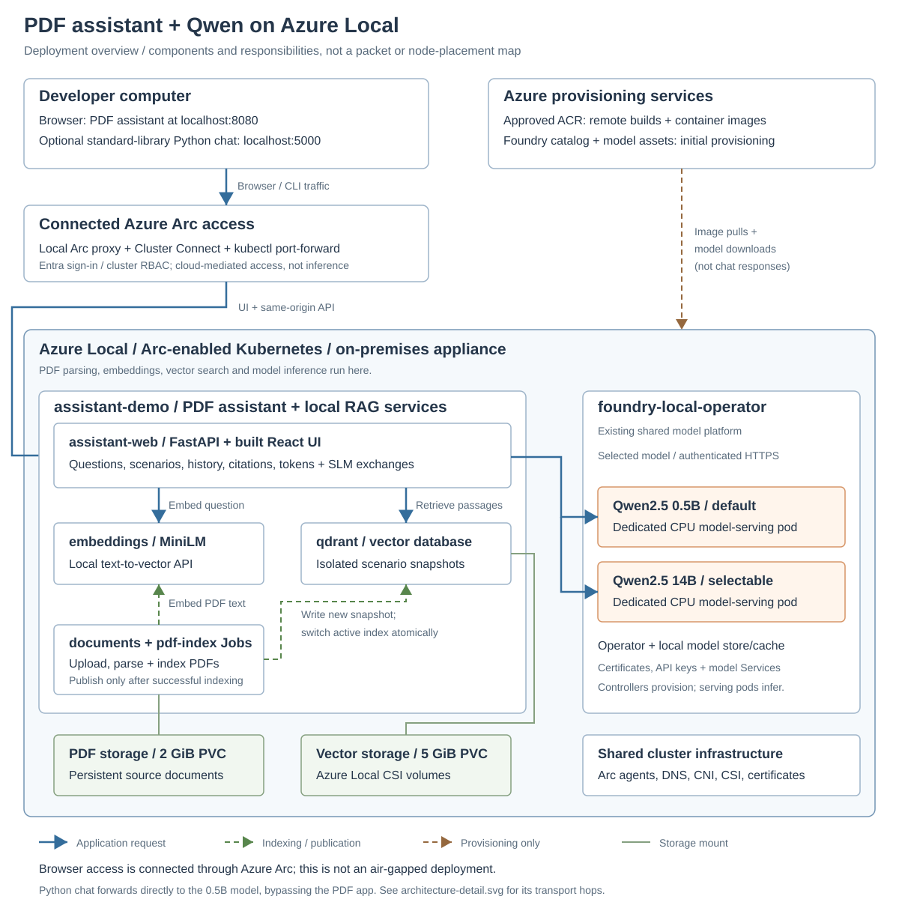
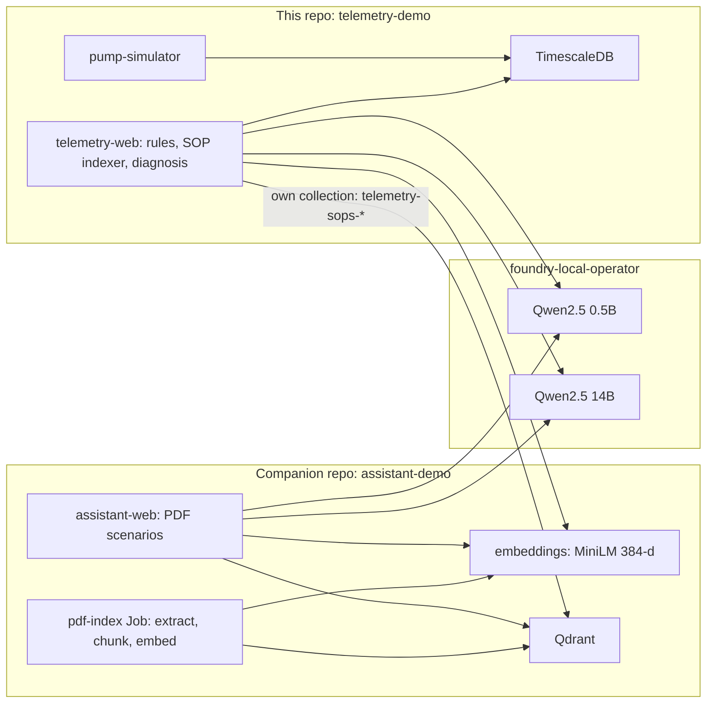

# Equipment telemetry AI agent on Azure Local

[Project overview](https://msft-innovation-hub-india.github.io/azure-local-telemetry-ai-agent/) |
[Source code](https://github.com/MSFT-Innovation-Hub-India/azure-local-telemetry-ai-agent)

Watch live, fictional pump telemetry, see deterministic rules open and escalate
alerts, and ask a locally hosted Qwen model to explain an incident from the
evidence and the company's own SOPs, with citations. The solution runs on an
existing **Azure Local appliance with an Azure Arc-enabled Kubernetes cluster** and
reuses the AI platform deployed by the
[warranty PDF assistant](https://github.com/MSFT-Innovation-Hub-India/azure-local-rag-assistant).

> All equipment, telemetry and SOPs are fictional training material. This is not
> an equipment protection system, a validated physical model or manufacturer
> guidance. AI explanations are advisory; deterministic rules determine alerts.

## What this showcases

1. **Time-series data and detection on the appliance.** A simulator writes
   correlated pump readings every ~2 s into **TimescaleDB** (PostgreSQL with the
   Timescale extension) on an Azure Local CSI volume. Python rules written from
   the SOPs evaluate *combinations* of signals over sustained windows every 5 s and
   persist alerts, acknowledgements and recovery history. No AI is in this loop.
2. **Local, grounded AI on the same platform as the warranty assistant.** On request,
   the app retrieves the relevant SOP sections with the shared MiniLM embedding
   service and Qdrant, and asks the selected Qwen2.5 model (0.5B or 14B) to explain
   impact, related checks and uncertainty. Diagnoses are saved with their model,
   evidence and sources. No external hosted LLM API is called.
3. **Reuse instead of rebuild.** The embedding API, Qdrant, Foundry Local models,
   credentials and trusted CA come from the companion project's deployment. This
   project adds only its own namespace (`telemetry-demo`) and one narrow network
   policy. See [how it builds on the companion](#how-this-solution-builds-on-the-warranty-assistant-platform).
4. **Familiar Kubernetes operations through Azure Arc.** `az connectedk8s proxy` gives
   local `kubectl` and port-forwards access to the cluster, so you use ordinary
   Kubernetes tooling without moving the workloads to Azure-hosted AKS.

**CPU-only walkthrough:** the lab had only CPU resources. Qwen2.5 0.5B and 14B run
on CPU through Foundry Local; no GPU is required. Prefer **14B** for the demo: the
0.5B model invented relationships between readings in an observed explanation.

**Important boundary:** local processing does not mean fully disconnected
operation. Browser access uses a cloud-mediated Arc tunnel, builds and model
provisioning need external connectivity, and platform monitoring can have outbound
flows. This demonstrates workload and data placement, not regulatory sovereignty.

## The scenario: three pumps, one bearing fault, one suction fault

A fictional water-circulation site has three centrifugal pump skids. Over a
repeating ten-minute cycle (healthy, fault ramp, sustained fault, recovery,
healthy) PUMP-001 develops a bearing problem, PUMP-002 a suction problem, and
PUMP-003 stays healthy as the control.

Try:

- Open the **Rule monitor**: amber means one condition of a rule holds, red means
  all of them have held together for the rule's window (bearing temperature **and**
  vibration, for example).
- Open the **Data store** panel: the counters are the real row count in
  TimescaleDB and the newest raw rows.
- Select the PUMP-001 incident, compare its evidence with the related checks, then
  **Generate diagnosis** with 14B and open the cited SOP section.
- Expand **Technical details** to see the exact model request/response and the
  token counts (0.5B reports them; streamed 14B responses do not).

The app never controls equipment, acknowledges alerts for you, or lets the model
change severity. A scripted recovery stands in for a technician's fix.

## Walk through the demo

| Order | Follow this page | Outcome |
|---|---|---|
| 1 | [Shared-service prerequisites](docs/DEPENDENCIES.md) | Confirm the cluster, models, embedding API and Qdrant exist (or build them from the companion project) |
| 2 | [Deploy the components](docs/DEPLOYMENT.md) | Build in your ACR, pass the guarded preflight, deploy the database, simulator and app, verify data is live |
| 3 | [Bring the demo up](docs/ANALYSIS.md#bringing-the-demo-up) | One script starts the Arc proxy and both browser tunnels |
| 4 | [Demo narrative and ten-minute walkthrough](docs/ANALYSIS.md#demo-narrative-who-does-what) | Present detection without AI, the evidence, an optional diagnosis, and resolution |

**Already deployed?** Run the access script, then open the URLs below:

```powershell
az login                                   # only if your Azure session has expired
.\tools\start-demo.ps1                     # telemetry on http://127.0.0.1:8090
.\tools\start-demo.ps1 -IncludeWarranty    # also the warranty assistant on :8080
```

| Application | Local browser URL |
|---|---|
| Telemetry agent (this project) | http://127.0.0.1:8090 |
| Warranty assistant (companion) | http://127.0.0.1:8080 |

The workloads keep running when the tunnels stop. After an app upgrade the pod is
replaced and its tunnel goes stale; the script restarts it, or re-run the script.
Manual commands and the parameters are in
[Bringing the demo up](docs/ANALYSIS.md#bringing-the-demo-up).

## How this solution builds on the warranty assistant platform

The [azure-local-rag-assistant](https://github.com/MSFT-Innovation-Hub-India/azure-local-rag-assistant)
repository deploys a reusable retrieval-augmented generation platform into the
`assistant-demo` namespace: an embedding API, a Qdrant vector database, the
document/indexing pipeline, and (through Foundry Local) the Qwen models. Its
warranty app is one consumer of that platform. **This project is a second
consumer**, with a different data source (live telemetry plus SOPs) and trigger
(an operator's request rather than a typed question).

The companion's own overview of that platform (the PDF assistant, the embedding
service, Qdrant and the Foundry Local Qwen deployments) is shown below. This is a
copy of its [architecture diagram](https://github.com/MSFT-Innovation-Hub-India/azure-local-rag-assistant#understand-the-solution)
([SVG](docs/images/companion-architecture.svg));
see that repository for the current version and the detail.



The diagram below adds this project's pieces to that platform.



### What is shared and what is not

| Shared piece | Provided by the companion | How this project uses it |
|---|---|---|
| Embedding service (`embeddings`, `POST /embed`, MiniLM `all-MiniLM-L6-v2`, 384 dimensions) | Turns text into vectors | Embeds the SOP sections at startup and the alert text at diagnosis time; rejects a response whose model, revision or dimensions differ |
| Qdrant (`qdrant`, port 6333, API-key auth) | Stores the assistant's passage collections and scenario catalog | Creates its own content-addressed collection `telemetry-sops-<hash>` and queries only that prefix; warranty collections are never read or written |
| Model catalog and credentials (`assistant-models` ConfigMap, `assistant-credentials` Secret) | Lists the Qwen models and holds the Qdrant and model keys | The deployer copies only the selected keys, model list and model CA into this project's own Secret and ConfigMaps; the sources are not modified |
| Qwen2.5 0.5B and 14B (Foundry Local) | Its `deploy/qwen2.5-*.yaml` manifests create them in the fresh-lab path | Calls the same endpoints with the same keys and CA, only when a diagnosis is requested |
| `assistant-demo` network | Isolates the assistant's pods | One extra NetworkPolicy ([deploy/shared-access.yaml](deploy/shared-access.yaml)) lets only `telemetry-web` reach Qdrant and the embeddings service |

Not shared: this project has its own UI, namespace, images, database, detector,
SOP catalog and diagnosis history. It does not use the assistant's application,
scenarios, PDFs or prompts. Shared services still share compute, so using both
demos at once can contend for embedding and model capacity; this app allows one
diagnosis at a time and the assistant has its own concurrency control.

### The same RAG stages, with a different source

| Stage | Companion: PDF scenarios | This project: SOPs |
|---|---|---|
| Content | PDFs in a scenario package, stored on a document PVC | Markdown SOPs in [sops/](sops), originals stored immutably in PostgreSQL by ID and revision |
| Extract | `pypdf` reads each page | None; the Markdown is read directly |
| Chunk | Fixed windows of up to 900 characters with 120 overlap, per page | One passage per uppercase `## SECTION-ID` heading, each at most 3,200 characters (16 passages from 3 SOPs). Rules reference these section IDs, so a section is the natural unit |
| Where chunking runs | A one-off `pdf-index-*` Job when a scenario is published | A background thread in `telemetry-web` at startup, retried every 60 s |
| Vectorize | Shared `embeddings` service | **The same service and model** |
| Store | A scenario's immutable Qdrant collection plus a catalog record | A content-addressed `telemetry-sops-*` collection in the **same Qdrant**, no catalog entry |
| Retrieve and answer | Question embedding, top passages, selected Qwen answer with page citations | Alert evidence embedding, top passages, selected Qwen explanation with SOP section citations |

### Adding new knowledge or documents

**A new or changed SOP for this app.** Edit the Markdown under `sops/`, give changed
content a new revision, rebuild only the app and redeploy. See
[SOP wording or new document](docs/DEVELOPMENT.md#sop-wording-or-new-document) and
[SOP publication and retrieval](docs/ARCHITECTURE.md#5-sop-publication-and-retrieval).

**A new document scenario (PDF chunking, embedding and indexing).** That pipeline
lives in the companion repository, which has the scenario definition, packaging,
publication and indexing runbook:

| Step | Companion documentation |
|---|---|
| What stays shared across scenarios | [What stays shared](https://github.com/MSFT-Innovation-Hub-India/azure-local-rag-assistant/blob/main/docs/SCENARIOS.md#what-stays-shared) |
| Create a scenario (definition, prompt, PDFs) | [1. Create a scenario](https://github.com/MSFT-Innovation-Hub-India/azure-local-rag-assistant/blob/main/docs/SCENARIOS.md#1-create-a-scenario) |
| Package it | [2. Package it](https://github.com/MSFT-Innovation-Hub-India/azure-local-rag-assistant/blob/main/docs/SCENARIOS.md#2-package-it) |
| Chunk, embed and publish to the cluster | [3. Publish to the existing cluster](https://github.com/MSFT-Innovation-Hub-India/azure-local-rag-assistant/blob/main/docs/SCENARIOS.md#3-publish-to-the-existing-cluster) |
| How chunking, MiniLM and Qdrant fit together | [Chunking, embeddings and vector storage](https://github.com/MSFT-Innovation-Hub-India/azure-local-rag-assistant/blob/main/ARCHITECTURE.md#chunking-embeddings-and-vector-storage) |
| Indexing code path | [Pipeline 1: ingest and index](https://github.com/MSFT-Innovation-Hub-India/azure-local-rag-assistant/blob/main/docs/DEVELOPMENT.md#pipeline-1-ingest-and-index-a-content-release) |

A published scenario lands in the same Qdrant and uses the same embedding service
this project uses, and appears in the warranty assistant's scenario list. It does
**not** appear in the telemetry UI: `telemetry-web` deliberately queries only its own
`telemetry-sops-*` collections (see `Knowledge.retrieve` in
[telemetry/knowledge.py](telemetry/knowledge.py)). Making telemetry diagnoses cite
PDFs would be a code change here, for example allowing a published scenario's
collection and reading its catalog record. That is not implemented, and it would
need its own isolation review because collection naming is not authorization.

## Understand the solution

```text
Three simulated pumps --current UTC samples--> TimescaleDB + 20 GiB PVC
                                                  |
                              five-second deterministic evaluation
                                                  |
                                     persistent alerts and history
                                                  |
Browser --> independent telemetry app --> telemetry evidence + original SOPs
                                      --> shared MiniLM embeddings / Qdrant
                                      --> selected local Qwen 0.5B or 14B
                                                  |
                                      saved advisory diagnosis
```

The [deployment architecture diagram](docs/ARCHITECTURE.md#2-deployment-architecture)
shows the namespaces, storage and every labeled connection.

| Topic | Focused documentation |
|---|---|
| Responsibilities and where an LLM is (not) used | [Scope and responsibilities](docs/ARCHITECTURE.md#1-scope-and-responsibilities) |
| Pods and containers, including `2/2`, `3/3` sidecars | [Pods and containers on the cluster](docs/ARCHITECTURE.md#pods-and-containers-on-the-cluster) |
| Time-series storage and why TimescaleDB | [Telemetry ingestion and data model](docs/ARCHITECTURE.md#3-telemetry-ingestion-and-data-model) / [Why TimescaleDB](docs/ARCHITECTURE.md#why-timescaledb-instead-of-a-plain-indexed-table) |
| Detection, windows and incident state | [Deterministic detection](docs/ARCHITECTURE.md#4-deterministic-detection-and-incident-state) |
| SOP chunking, embedding and retrieval | [SOP publication and retrieval](docs/ARCHITECTURE.md#5-sop-publication-and-retrieval) / [Diagnosis sequence](docs/ARCHITECTURE.md#6-diagnosis-request-sequence) |
| Model modes and token counts | [Transport, response modes and tokens](docs/ANALYSIS.md#model-transport-response-modes-and-token-counts) |
| Network, trust and capacity | [Boundaries](docs/ARCHITECTURE.md#7-resource-network-and-trust-boundaries) / [Trade-offs and production gaps](docs/ARCHITECTURE.md#9-deliberate-trade-offs-and-production-gaps) |
| Shared-service contracts and fresh-lab setup | [Prerequisites](docs/DEPENDENCIES.md) |
| Images, YAML and guarded deployment | [Deployment guide](docs/DEPLOYMENT.md) / [Application-only upgrade](docs/DEPLOYMENT.md#application-only-upgrade) |
| Code map, APIs and tests | [Code and extension guide](docs/DEVELOPMENT.md) |
| Using the UI, troubleshooting and recovery | [Demo and operations runbook](docs/ANALYSIS.md) / [Troubleshooting by layer](docs/ANALYSIS.md#troubleshooting-by-layer) |

**For a new environment:** follow the deployment guide from the beginning. Do not
apply the YAML files directly; they contain placeholders, and the deployers perform
ownership, placement, capacity, credential and migration checks.

This project deploys TimescaleDB, the simulator and the telemetry app only. The
cluster, storage driver, Foundry Local models, embedding API and Qdrant must satisfy
the [documented prerequisites](docs/DEPENDENCIES.md). Azure IoT Operations, MQTT,
Azure IoT Hub and Azure-hosted database services are **not required**.

TimescaleDB is PostgreSQL extended by **Timescale/Tiger Data**, not a
Microsoft-provided database container. Its pinned upstream image is mirrored to your
approved ACR. Review the [upstream instructions](https://github.com/timescale/timescaledb-docker)
and [license](https://github.com/timescale/timescaledb/blob/main/LICENSE) before
redistribution or production use.

## Verified on November 13, 2026

- TimescaleDB 2.32.0 on PostgreSQL 17, a real hypertable and persistent CSI volume.
- Live ingestion, duplicate rejection, least-privilege writer and persistence.
- Warning, critical escalation, acknowledgement and sustained recovery.
- Three SOPs indexed; diagnoses saved with model identity, evidence and sources.
- Both models returned HTTP 200: 0.5B took 14.96 s; 14B took 74.87 s.
  These were individual requests, not a benchmark.
- All 67 other active pods retained their identities, placement and restart counts
  during the final deployment checks. Later UI releases were checked the same way.

## Keep the lab safe

- Reuse existing Arc, networks, Foundry, model, embedding and Qdrant resources.
  Application writes are additive and confined to `telemetry-demo`, plus the one
  documented NetworkPolicy in the shared-service namespace.
- Deployments do not scale infrastructure or reapply existing model, embedding,
  Qdrant or warranty pod templates. Upgrades require `--preserve-placement`, and
  changes to existing resource requests/limits are refused. Do not lower requests
  or move workloads to fit the demo.
- Credentials stay backend-only. Do not commit keys, tenant/subscription IDs or
  kubeconfigs. Image-pull tokens are short-lived; refresh them before pulls.
- Scenario/collection naming is isolation, **not authorization**: anyone who can
  reach the demo can use it. The database and app are single replica, and there is
  no end-user auth, database TLS, backups/HA, external alert delivery or equipment
  control. Read the architecture and operations guides before adapting it.

## Public project page

GitHub Pages publishes the project overview from `docs/index.md`, using the
`main` branch's `/docs` folder. `docs/_config.yml` configures the Cayman theme,
SEO metadata and generated sitemap; `docs/robots.txt` advertises the sitemap.
The page is crawlable, but search engines decide whether and when to index it.
