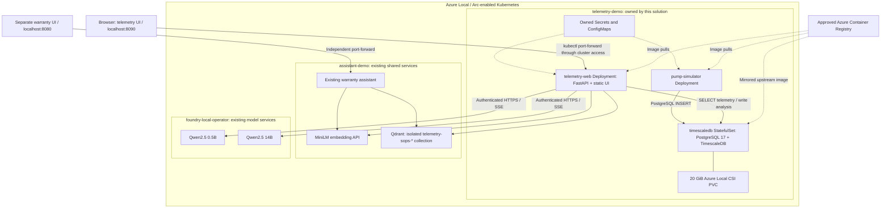

# Architecture and design

See the [deployment guide](DEPLOYMENT.md) for executable commands and the
[code guide](DEVELOPMENT.md) for implementation entry points.

## 1. Scope and responsibilities

The scenario is a fictional water-circulation installation with three centrifugal
pump skids. A skid includes a motor, bearing, lubrication circuit and hydraulic
measurements. The system observes already-running equipment; it never commands it.

The "agent" is an application-controlled diagnostic orchestrator. It gathers
bounded telemetry evidence and related parameters, retrieves SOP passages, and
asks the operator-selected LLM to explain the situation. It is not an autonomous
tool-execution loop. The model cannot issue SQL, acknowledge alerts, clear alarms,
operate equipment or approve maintenance.

| Responsibility | Implementation | Requires an LLM? |
|---|---|---|
| Generate timestamped measurements | Simulator | No |
| Persist time-series readings | TimescaleDB | No |
| Detect, escalate and resolve conditions | Python rules and detector | No |
| Persist acknowledgements/history | Application and PostgreSQL | No |
| Store original SOP revisions | PostgreSQL document tables | No |
| Index/retrieve relevant SOP sections | MiniLM embeddings and Qdrant | No generative model |
| Explain impact, related checks and uncertainty | Selected Qwen model | Yes, on demand |

## 2. Deployment architecture



Arc provides the connected management/access path. Azure hosts the registry/build
service in this workflow; inference, embedding, vector search, simulation and
database processing run on the appliance. This is **not** an air-gapped deployment:
initial provisioning/builds/image or model downloads need external connectivity,
and the demonstrated browser access uses the Arc proxy.

The ACR and cluster can be in different subscriptions or approved tenants.
Registry sign-in uses an isolated Azure CLI profile; Kubernetes writes use an
explicit context. The deployment scripts never switch the operator's ordinary
Azure CLI subscription.

## 3. Telemetry ingestion and data model

### Measurements

Each iteration captures current UTC time and constructs a three-row transaction,
one row per asset, then waits approximately two seconds after a successful write.
The process uses a monotonic clock for fault-cycle progression, not wall-clock
differences. Scheduling, database latency and retry delays make the interval
approximate.

| Field | Unit / purpose |
|---|---|
| `measured_at`, `ingested_at` | Source UTC event time; independently recorded database arrival time |
| `event_id`, `run_id`, `sequence` | Retry identity, simulator process identity and per-batch sequence |
| `equipment_id` | PUMP-001, PUMP-002 or PUMP-003 |
| `scenario` | Test-only ground truth; excluded from diagnostic evidence |
| `quality`, `operating_state` | Current schema permits only `good` and `running` |
| `speed_rpm`, `motor_current_a` | Drive speed and load |
| `motor_temperature_c`, `bearing_temperature_c`, `ambient_temperature_c` | Correlated thermal observations |
| `vibration_mm_s` | Fictional overall RMS vibration, not a vibration spectrum |
| `suction_pressure_bar`, `discharge_pressure_bar` | Gauge pressures |
| `flow_m3_h`, `lubricant_pressure_bar` | Delivery and lubrication indicators |

PUMP-001 increases bearing heat/vibration while lubricant pressure falls.
PUMP-002 loses suction/discharge pressure and flow while vibration rises.
PUMP-003 remains a healthy reference. Small noise and correlated load variation
make the readings plausible, not a validated physical simulation.

| Simulator elapsed time, repeating every 600 s | Behavior |
|---|---|
| 0-120 s | Healthy |
| 120-300 s | Fault amplitude ramps from zero to one |
| 300-420 s | Sustained fault |
| 420-540 s | Recovery to zero |
| 540-600 s | Healthy |

### Storage

| Object | Purpose / retention |
|---|---|
| `telemetry.equipment` | Synthetic asset inventory |
| `telemetry.samples` | Actual hypertable, daily chunks, seven-day asynchronous retention |
| `telemetry.latest` | Latest event-time sample per asset |
| `analysis.schema_migrations` | Applied analysis schema version |
| `analysis.sop_documents` | Original Markdown, title, immutable ID/revision, SHA-256 |
| `analysis.sop_active` | Active revision pointer per document |
| `analysis.index_status` | Published collection, package digest, passage count and index time |
| `analysis.alerts` | Incident state, highest severity, evidence, SOP reference and lifecycle times |
| `analysis.alert_events` | Opened, escalated, acknowledged and resolved history |
| `analysis.diagnoses` | Historical answer, selected model, evidence, sources, optional usage, elapsed time and the exact model request/response (`exchange`, null for earlier rows) |

The sample primary key is `(measured_at, event_id)`, with an asset/time index.
The simulator retries the **same pending event IDs and timestamps**, using
`ON CONFLICT DO NOTHING`, so an uncertain commit does not duplicate that batch.
The untargeted conflict clause preserves the writer's insert-only privileges.

Pending data is memory-only. Restarting the simulator can lose that pending batch
and starts a new run/cycle. It does not backfill invented historical samples.
There is no durable device queue, MQTT broker or exactly-once end-to-end guarantee.

At the nominal rate, three rows every two seconds is approximately 129,600 rows
per day. The 20 GiB allocation is a lab choice, not a measured retention/capacity
guarantee. Measured on the demo cluster: about 926,000 rows occupied 330 MB
(roughly 350 bytes per row including indexes) across eight daily chunks. Because
retention drops whole daily chunks, the table holds seven to eight days, about
one million rows or 0.4 GB, so the 20 GiB volume is not at risk from telemetry
alone; the UI's data-store panel shows the live size and retention window. The
web application's database role is read-only for telemetry, so the UI has no
purge control: adjust retention in `db/001-schema.sql` or have an operator run
`drop_chunks` as the database administrator. There is no configured compression or continuous aggregate; charts use
ordinary time-bucket queries. Analysis/history tables and old Qdrant collections
do not have automatic retention.

PostgreSQL is also the document store because three small versioned Markdown
documents do not justify another service or PVC. Qdrant is a derivative retrieval
index, not the authoritative store of original documents.

## 4. Deterministic detection and incident state

A dedicated thread evaluates every five seconds using database time and the last
120 seconds of samples. A transaction-scoped advisory lock prevents overlapping
detector transactions. One active alert per asset/rule is enforced by a partial
unique index, not just an application lookup.

| Condition | Warning | Critical | Clear |
|---|---|---|---|
| Bearing | Temperature >=75 C AND vibration >=4 mm/s, 30 s | Temperature >=85 C AND vibration >=6 mm/s, 20 s | Temperature <=70 C AND vibration <=3 mm/s, 30 s |
| Suction | Pressure <=1 bar AND flow <=34 m3/h, 30 s | Pressure <=0.6 bar AND flow <=28 m3/h AND vibration >=4.5 mm/s, 20 s | Pressure >=1.2 bar AND flow >=38 m3/h, 30 s |
| Telemetry stale | Latest observation older than 15 s, or no recent observation | Not used | Fresh continuous data for 20 s |

A sustained window needs an observation at/before its cutoff, freshness at the
end and no gap greater than six seconds. All samples in the window must have
good quality, running state and satisfy every condition. Future timestamps are
excluded. In the current schema all accepted measurements are good/running;
ingesting other states requires a schema and behavior change.

```text
No incident -> warning or critical -> optional escalation to critical
                               \-> optional acknowledgement
                               \-> sustained clear -> resolved
Resolved -> later recurrence creates a new incident ID
```

Critical severity is sticky until the full clear condition. Warning-level
recovery does not downgrade it. Missing data opens/maintains staleness and does
not resolve mechanical incidents. Acknowledgement is idempotent and does not
clear anything.

The evidence snapshot contains the latest qualifying condition/duration and
60-second min/max/latest values, count and largest sample gap. It is updated
while a rule is satisfied; it is not an immutable copy of the very first trigger.
The incident's highest severity may therefore be critical while its most recent
qualifying evidence describes warning-level recovery. Event history preserves
the escalation, and each diagnosis preserves its own supplied evidence.

## 5. SOP publication and retrieval

1. On app startup, load the catalog and Markdown originals.
2. Compare each original's checksum against its stored ID/revision. A changed
   original with an unchanged revision fails explicitly.
3. Store originals and update active pointers transactionally.
4. Split only uppercase `## SECTION-ID` headings into sections, each <=3,200
   characters. The current three-document package produces 16 passages.
5. Compute a digest over ordered document IDs, revisions and content checksums.
6. Create/validate `telemetry-sops-<first-24-digest-characters>` in Qdrant:
   384-dimensional cosine vectors, deterministic UUID5 point IDs.
7. Embed batches of eight with the exact MiniLM model/revision, upsert with
   `wait=true`, and verify the resulting point count.
8. Publish index status only after all expected passages exist.

The indexer runs separately from detection and retries dependency failures every
60 seconds. The app can remain detector-ready while indexing is unavailable;
the overview reports the separate index error and diagnoses are disabled.
Startup failures such as an invalid catalog or immutable revision mismatch are
not hidden as a healthy empty knowledge base.

Collections belonging to the warranty assistant are never queried, renamed,
replaced or deleted by this application's indexing code. Content naming is
logical isolation, **not** per-collection authorization.

## 6. Diagnosis request sequence

```mermaid
sequenceDiagram
    actor User
    participant UI as Telemetry UI
    participant App as FastAPI orchestrator
    participant DB as PostgreSQL
    participant RAG as Embeddings / Qdrant
    participant LLM as Selected local Qwen
    User->>UI: Select alert and model; Generate diagnosis
    UI->>App: POST /api/alerts/{id}/diagnose
    App->>App: Validate model/index; acquire nonblocking lock
    App->>DB: Read alert and last 90 seconds of telemetry
    App->>App: Build trigger/current evidence and missing checks
    App->>RAG: Embed query; retrieve top four SOP passages
    App->>App: Exact rule-supporting passage + up to two distinct retrieved passages
    App->>LLM: Authenticated TLS request; temperature 0; non-streaming (0.5B) or streaming (14B)
    LLM-->>App: JSON with usage, or SSE deltas + finish reason + DONE (no usage)
    App->>App: Validate response/source identifiers/usage metadata
    App->>DB: Save answer, model, sources and evidence snapshot
    App-->>UI: Completed saved diagnosis
```

The evidence includes possible impact, related measured parameters and explicitly
missing independent observations. Scenario labels are excluded. The prompt asks
for short, cited observations/impact/validation/uncertainty without physical
intervention instructions. This is a prompt constraint, not a reliability guarantee:
the 0.5B model demonstrably failed to follow it.

The backend supports two response modes. **Non-streaming** returns one JSON
response whose `usage` gives exact input/output/total token counts, but the existing
model proxy cuts off non-streaming responses after about 60 seconds. **Streaming**
consumes SSE, which avoids that limit for slow answers, but the model server returns
no usage in streaming mode (verified: the same model reports usage non-streaming and
none when streaming, despite requesting it). The default is non-streaming for the
fast 0.5B model and streaming for 14B (`STREAMING_RECOMMENDED` in `knowledge.py`);
the operator can override it per request, and the UI asks for confirmation before
sending 14B non-streaming because the gateway may return HTTP 504. Both paths share
validation: a supported finish reason (and the event-stream content type and `[DONE]`
when streaming), out-of-range `[S#]` references and invalid reported usage are
rejected; the narrative is not fact-checked and citations are not guaranteed.
Missing token counts are displayed explicitly and never estimated. A reported `length`
finish appends a partial-output notice. The mode used is recorded in the saved
request (`exchange.request.stream`).

The client uses a 300-second HTTP timeout and, when streaming, checks elapsed time
between stream lines. This is not a guaranteed hard wall-clock cancellation of remote
inference. The browser receives the answer after completion, not incremental tokens.

Only one diagnosis runs per app process; simultaneous requests return HTTP 409.
There is no global queue shared with the warranty app. Keep one replica and one
Uvicorn worker unless concurrency, coordination and indexing are redesigned.

## 7. Resource, network and trust boundaries

| Workload | CPU request / limit | Memory request / limit | Persistence |
|---|---|---|---|
| TimescaleDB | 500m / 1 | 1 GiB / 2 GiB | One 20 GiB PVC |
| Simulator | 50m / 250m | 128 MiB / 128 MiB | None |
| Telemetry web | 200m / 1 | 384 MiB / 768 MiB | Analysis stored in DB |

Total requests: 750m CPU / 1,536 MiB. Total limits: 2.25 CPU / 2,944 MiB.
Namespace quota: 1.5 CPU / 3 GiB requests, 3 CPU / 4 GiB limits, one 20 GiB PVC.
These numbers **exclude** the existing models, Qdrant and embedding services.

The capacity guard counts allocated requests, native sidecars, init peaks and
pod overhead. Foundation admission requires >=4,224 MiB and 2.25 CPU unreserved
after its exclusions. Analysis admission budgets the full telemetry stack plus
headroom: >=4,992 MiB and 3.25 CPU after excluding owned stack pods.
These are conservative reservation checks, not observed utilization or promises
of zero interference. Only Ready, untainted, unpressured workers are candidates.

| Traffic | Port / controls |
|---|---|
| Simulator/app -> own database | TCP 5432, namespace-local policies |
| App -> Qdrant | TCP 6333, API key, matching ingress and egress policies |
| App -> embeddings | TCP 8001, narrow policies |
| App -> model Service | HTTPS 5000; current target pod port 8443 permitted by policy |
| Stack -> CoreDNS | UDP/TCP 53 to selected CoreDNS pods |
| Browser -> app | Localhost port-forward; no public ingress provided |

All three owned workloads run non-root, without service-account tokens, with
read-only root filesystems, dropped capabilities and RuntimeDefault seccomp.
Writable data/temp/socket paths are explicit volumes.

| Database role | Runtime privileges |
|---|---|
| `postgres` | Initialization/migration/administration; not given to the simulator or app |
| `telemetry_writer` | INSERT samples only |
| `telemetry_reader` | SELECT telemetry tables/views |
| `telemetry_app` | SELECT telemetry; SELECT/INSERT/UPDATE analysis and sequence access; no raw mutation/schema creation |

Passwords are random, created in memory and stored in owned Secrets. Shared keys
and the model CA are copied into the telemetry namespace without printing or
writing credential files. Model TLS verification remains enabled.
Database, embedding and Qdrant transport are not TLS-protected in this lab.
NetworkPolicy is not encryption. The reused Qdrant key is not tenant isolation.
Local PostgreSQL socket trust makes database `pods/exec` access administrative.

## 8. Deployment and failure design

- Foundation and analysis deployments are separate and default to read-only
  preflight. Preflight can read selected Secrets and exec read-only SQL.
- Ownership label: `app.kubernetes.io/part-of=realtime-telemetry`. Existing
  unowned resources cause refusal, not adoption.
- Initial placement pins each pod template to a worker hostname. Upgrades require
  `--preserve-placement` and refuse request/limit changes or implicit relocation.
- Foundation schema runs only on an empty data directory. Analysis migration runs
  transactionally with an advisory lock, without restarting the DB.
- Analysis deploys only its app plus one explicitly permitted shared-access
  NetworkPolicy; it never reapplies foundation or shared pod templates.
- Recreate strategies avoid extra simulator/app replicas during upgrades, at the
  cost of a short gap. A database replacement has an ingestion outage; the
  simulator logs connection failures and retries its pending batch.
- `/healthz` is process health; `/readyz` requires a detector tick within 25 s.
  Neither proves the SOP index or a model works.
- An unavailable original node, missing credentials for existing data, incompatible
  embeddings, an unavailable index or inference failure stops visibly.

## 9. Deliberate trade-offs and production gaps

Direct SQL ingestion avoids IoT Operations/MQTT prerequisites for the initial
demo. An adapter or broker can be added later without making the LLM the alert
authority, but would need real identity, quality, ordering and delivery semantics.

There is no end-user authentication, production ingress, RBAC within the UI,
external notifications, work orders, backups/PITR, database HA, automatic
credential synchronization, durable ingest queue or equipment actuation.
The ACR pull token is temporary and retains the signed-in identity's permissions.
Images have digest references, but the Python base tag and transitive dependencies
are not a complete bit-for-bit reproducible supply-chain lock.

Moving to real telemetry requires approved SOPs, calibrated instrumentation,
clock/quality/state handling, load and accuracy evaluation, independent safety
controls, durable identities, encrypted transports, authorization, backups,
retention/cleanup and supported infrastructure operations. These are not enabled
by switching the simulator off.
