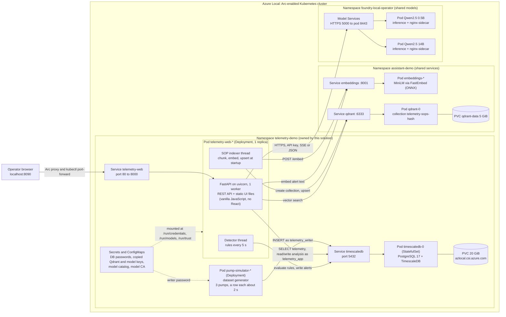
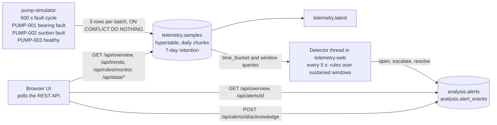
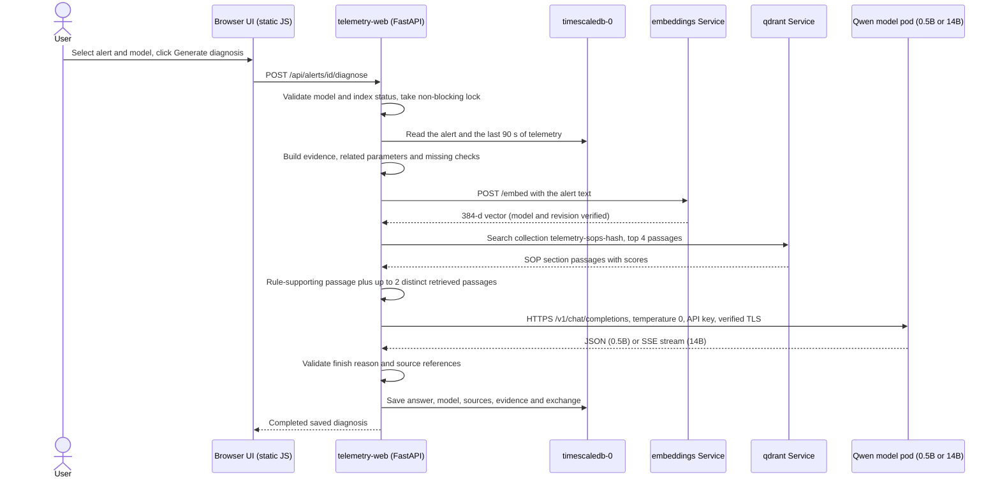
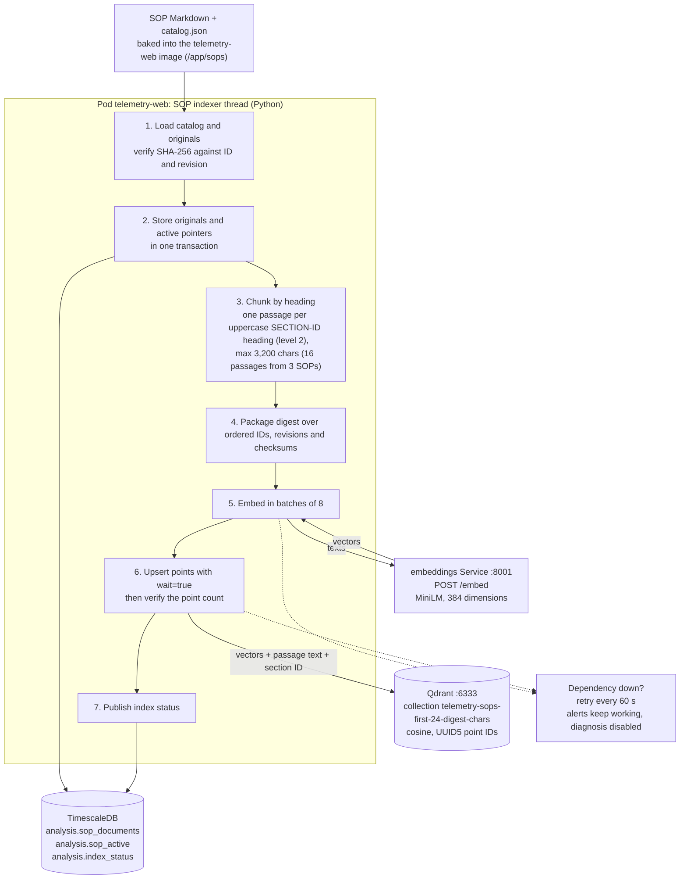
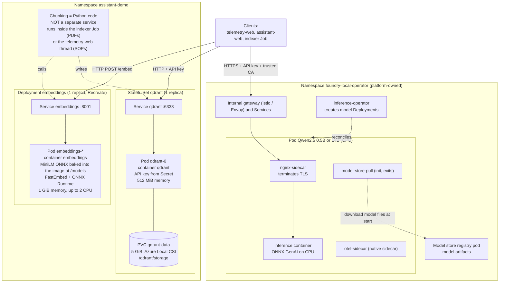
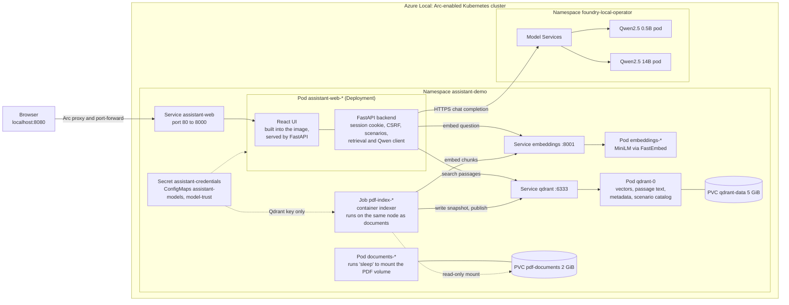
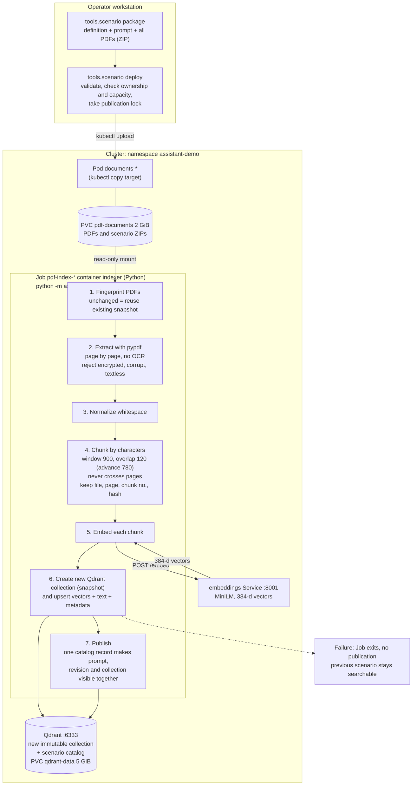
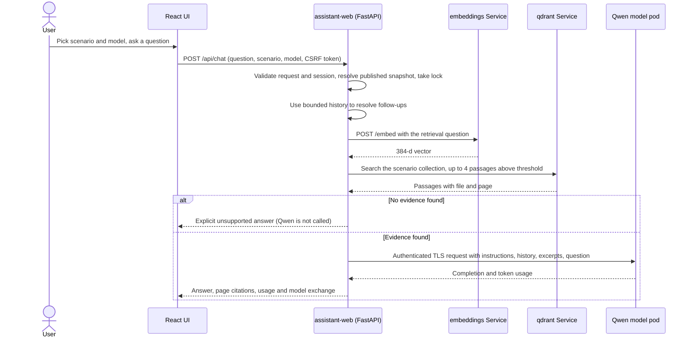

# Solution architecture diagrams (inside the Kubernetes cluster)

These diagrams show only what runs **inside the Arc-enabled Kubernetes cluster**.
Azure-side pieces (Arc, ACR, Entra) are outside the scope except where they touch
a pod. For the prose, see [ARCHITECTURE.md](ARCHITECTURE.md); for commands, see
[DEPLOYMENT.md](DEPLOYMENT.md).

| Part | Diagram |
|---|---|
| Telemetry analysis (this repo) | [1. Pods and services](#1-telemetry-analysis-pods-services-and-storage), [2. Runtime flows](#2-telemetry-analysis-runtime-flows), [3. SOP indexing pipeline](#3-telemetry-analysis-sop-indexing-pipeline) |
| Shared services | [4. How the common services are hosted](#4-shared-services-how-they-are-hosted) |
| PDF assistant (companion repo) | [5. Pods and services](#5-pdf-assistant-pods-services-and-storage), [6. Document ingestion pipeline](#6-pdf-assistant-document-ingestion-pipeline), [7. Question runtime](#7-pdf-assistant-question-runtime) |

**Terminology used in this solution**

| You may say | In this solution |
|---|---|
| Dataset generator | `pump-simulator` Deployment (`python -m telemetry.simulator`) |
| Database | TimescaleDB (PostgreSQL 17 + Timescale extension) in `timescaledb-0` |
| Model | Qwen2.5 0.5B or 14B on CPU, served by Foundry Local |
| Model API | HTTPS `/v1/chat/completions` behind an `nginx-sidecar` in each model pod |
| UI | **Telemetry app: plain HTML/CSS/JavaScript** in `static/`, served by FastAPI (no React). **PDF assistant: React**, built into its FastAPI image |
| Vector database | Qdrant, `qdrant-0` StatefulSet |
| Embedding service | MiniLM (`all-MiniLM-L6-v2`, 384 dimensions) running with FastEmbed/ONNX in the `embeddings` Deployment |
| Chunking | Plain Python code inside the app or indexer process. Neither Qdrant nor MiniLM chunks |

---

## 1. Telemetry analysis: pods, services and storage

Key points:

- **One image, two roles.** The simulator and the web app are built from the same
  image; only the command differs (`telemetry.simulator` vs `uvicorn telemetry.app:app`).
- **Three pods owned here**, each `1/1` with no sidecars. Everything else is reused.
- **Database access is least-privilege**: the simulator can only insert samples; the
  app can read telemetry and read/write analysis tables.
- **Network access is explicit.** `telemetry-private-network` limits the namespace;
  `telemetry-analysis-access` allows `telemetry-web` egress to Qdrant (6333),
  embeddings (8001) and the two model pods (8443). One additive policy in
  `assistant-demo` ([shared-access.yaml](../deploy/shared-access.yaml)) admits that
  traffic on the receiving side.
- **No ingress.** Access to the browser UI is through a port-forward over the Arc
  connection.

---

## 2. Telemetry analysis: runtime flows

Three separate flows run at runtime. Only the third involves an LLM.

### 2a. Continuous: ingestion and deterministic detection (no AI)

### 2b. On request: diagnosis (retrieval plus a local LLM)

A second request while one is running gets HTTP 409. The model cannot run SQL,
acknowledge alerts or change severity.

---

## 3. Telemetry analysis: SOP indexing pipeline

This is the telemetry app's version of "document upload". It is **not** a Job and has
no upload step: the SOP Markdown ships inside the app image, and an indexer thread
inside `telemetry-web` publishes it at startup.

Changed SOP content with an unchanged revision fails loudly. A new revision produces
a new digest, hence a new collection. Old collections are not deleted automatically.

---

## 4. Shared services: how they are hosted

These run in `assistant-demo` and `foundry-local-operator`. They come from the
[companion repository](https://github.com/MSFT-Innovation-Hub-India/azure-local-rag-assistant).
The telemetry app and the PDF assistant both consume them.

| Service | Hosted as | Storage | Reached by | Controls |
|---|---|---|---|---|
| Qdrant | StatefulSet, 1 pod | 5 GiB CSI PVC | `qdrant.assistant-demo:6333` | API key in a Secret, NetworkPolicy, no TLS |
| Embedding service | Deployment, 1 pod, stateless | None; model baked into image | `embeddings.assistant-demo:8001` `POST /embed` | NetworkPolicy, no auth, no TLS |
| Chunking | Python library code in the caller | None | In-process | N/A |
| Qwen models | Foundry Local operator creates one Deployment per model | Model files pulled into the pod at start | HTTPS Service port 5000 to pod port 8443 | API key, TLS with a trusted CA |

---

## 5. PDF assistant: pods, services and storage

The PDF assistant is deployed from the companion repository into `assistant-demo`.
Source details are in its [ARCHITECTURE.md](https://github.com/MSFT-Innovation-Hub-India/azure-local-rag-assistant/blob/main/ARCHITECTURE.md)
and [deploy/stack.yaml](https://github.com/MSFT-Innovation-Hub-India/azure-local-rag-assistant/blob/main/deploy/stack.yaml).

The web pod does **not** mount the PDF volume. It answers from the passages, text and
metadata stored in Qdrant, so the PDFs are needed only at indexing time.

---

## 6. PDF assistant: document ingestion pipeline

This runs **when a content release is published**, not on each question.

| Step | Where it runs | Component |
|---|---|---|
| Upload | Operator workstation to `documents` pod | `kubectl` over the Arc connection |
| Extraction, chunking, orchestration | One-off `pdf-index-*` pod (`indexer` container) | Python: `pypdf` plus the `extract_chunks` function |
| Embeddings | `embeddings` pod | MiniLM via FastEmbed/ONNX |
| Vector storage | `qdrant-0` pod | Qdrant on a 5 GiB CSI volume |
| Scheduling constraint | Indexer pod affinity | Must land on the node where `documents` runs, because the 2 GiB volume is ReadWriteOnce |

Indexing is a one-off Job (`backoffLimit: 0`, 30-minute deadline). Finished pods show
`0/1 Completed`; that is normal. It is not incremental: any changed or removed PDF
triggers a complete new snapshot for that scenario.

---

## 7. PDF assistant: question runtime

---

## Notes and caveats

- **UI technology.** The telemetry UI in [static/](../static) is vanilla JavaScript.
  Only the PDF assistant uses React.
- **Sections 4 to 7 describe the companion repository** as documented on its `main`
  branch at the time of writing. If its manifests change, treat its repository as the
  source of truth.
- **Shared services do not isolate tenants.** Collection naming
  (`telemetry-sops-*` vs scenario collections) is logical separation, not
  authorization. Both apps use the same Qdrant API key.
- **Single replicas everywhere.** The database, the apps, Qdrant and the embedding
  service each run one replica. Both apps allow one generation at a time.
